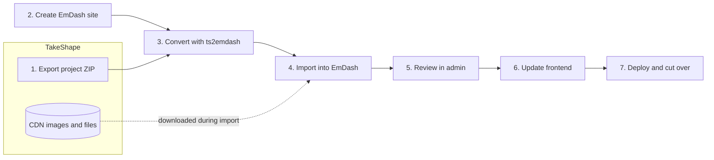

# Migrating from TakeShape to EmDash

2026-10-05 · Mark Catalano

## Overview

TakeShape shuts down on **December 31, 2026**, and every project, its content, its assets, and its APIs are deleted that day. This guide moves a TakeShape CMS project to [EmDash](https://emdashcms.com), an open source, agent-ready CMS for Astro from Cloudflare, using a conversion script we built and tested against TakeShape's own sample projects.

Aim to finish by **[December 1, 2026]** so you have time to test. Images and files are copied from TakeShape's CDN while you import, so the import itself has to run before December 31.

**What moves:** your content model, every entry with its published or draft status, rich text (with headings, lists, links, pullquotes, captioned images and embeds), images and files, relationships, plus tags or categories.

**What stays behind:** data that TakeShape fetched from connected services (Shopify, REST, GraphQL), users and roles, API keys, custom workflow steps beyond published and draft, and locales other than your default. For non-CMS uses of TakeShape, see [recommendation for API mesh and agent projects].

The path has seven steps. Steps 1 to 5 are mostly automated; updating your frontend (step 6) is usually the biggest piece of work.



Only the export and the import touch TakeShape. Once step 4 finishes cleanly, everything else runs on EmDash alone.

**Does TakeShape build your website too?** If your site's folder has a `tsg.yml`, TakeShape's static site generator (takeshape-ssg) builds it. Follow [Moving a takeshape-ssg site](#moving-a-takeshape-ssg-site) instead of the steps below. It moves your content, translates the site itself to Astro on EmDash, and checks every page against your live site.

## Before you start

You need five things in place:

- **Node.js 22.18 or later.** The conversion script is written in TypeScript, and Node runs TypeScript directly from 22.18. Check with `node --version`.
- **Admin access to your TakeShape project**, so you can export it.
- **The conversion script, `ts2emdash.mts`.** Download it from this folder: [`ts2emdash.mts`](ts2emdash.mts).
- **A machine that can reach `images.takeshape.io` and `assets.takeshape.io`.** The import downloads every image and file from there.
- **A hosting choice for EmDash:** a Node.js server (SQLite and local files) or Cloudflare Workers (D1 and R2). You can decide at step 7; the import works the same either way.

If TakeShape served content to a website or app, have that codebase handy for step 6.

## Step 1: Export your TakeShape project

Export each project **with its data**. You get a ZIP holding `schema.json` (your shapes and fields), `data.jsonl` (every entry and asset record), `pattern.yml`, and `roles.json` if you have custom roles. The ZIP does not contain the image files themselves; step 4 downloads those from TakeShape's CDN.

Pick whichever route suits you:

- **Web app:** open **Project Settings** and select **Export This Project**. The download starts on its own.
- **CLI:**

```bash
npm i -g @takeshape/cli
takeshape login
takeshape link
takeshape export --project --to ./takeshape-export
```

- **API:** run the `exportProject` mutation, then poll `getProjectExport(id: …)` until `status` is `completed` and `file` holds the download URL. Don't pass `empty: true`, which exports the structure without content.

Keep the ZIP somewhere safe. It is your backup of the project after December 31. For a backup of the image and file bytes too, add `--download-assets ./takeshape-assets` when you run the script in step 3.

## Step 2: Create your EmDash site

Create a local EmDash project with the **Node.js** deploy target. It stores content in a SQLite file (`data.db`) and media in `./uploads`, which is exactly where the import writes. If you will host on Cloudflare, treat this project as your migration workspace and move the finished site in step 7.

```bash
npm create emdash@latest
```

At the prompts, choose:

- **Where will you deploy?** Node.js
- **Which template?** Starter or Blog (both work; the import adds your own collections next to theirs)
- **Install dependencies?** Yes

Then `cd` into the project. **Don't run `npm run dev` or the setup wizard yet.** Importing first means the setup wizard in step 5 opens onto your own content.

## Step 3: Convert the export with ts2emdash

`ts2emdash.mts` reads your export and writes an EmDash seed file (your collections with their fields, plus taxonomies and entries) plus a migration report. Rich text lands in Portable Text, the format EmDash's editor uses: Draft.js rich text converts block by block, following TakeShape's own renderer, and Markdown goes through EmDash's Markdown converter.

Copy `ts2emdash.mts` into your project folder and point it at the ZIP from step 1 (or the unzipped folder). It uses the `emdash` package your project already has:

```bash
node ts2emdash.mts ~/Downloads/takeshape-export.zip
```

It writes three files:

- `seed/takeshape.seed.json`, the file you import in step 4
- `seed/takeshape-field-map.json`, which records where each TakeShape shape and property went. The site translator reads it (see [Moving a takeshape-ssg site](#moving-a-takeshape-ssg-site)). Its `single` and `reverse` entries are there for you to read: the translator takes single shapes and reverse fields from the export's schema.
- `takeshape-migration-report.md`, a per-collection map of every TakeShape property to its EmDash field, plus anything that needs a decision from you

**Read the report before importing.** Three sections matter most:

- **Needs your attention:** relationships to missing entries, slugs that were renamed to stay unique, and rich text the script kept as plain text or as TakeShape's own HTML
- **Links to TakeShape-hosted files:** links inside rich text that point at `images.takeshape.io` or `assets.takeshape.io`. These break on December 31; upload those files to the EmDash media library and update the links after import.
- **Not migrated:** fields resolved from connected services, and anything you skipped

| Option | What it does |
| --- | --- |
| `--out <file>` | Seed file path (default `seed/takeshape.seed.json`) |
| `--report <file>` | Report path (default `takeshape-migration-report.md`) |
| `--field-map <file>` | Field map path (default `takeshape-field-map.json` next to the seed) |
| `--site <dir>` | Your takeshape-ssg site's folder (or its `tsg.yml`): each entry gets the slug its page had in your site's URLs. Needs the whole `emdash/` folder of this repo (see [Moving a takeshape-ssg site](#moving-a-takeshape-ssg-site)). |
| `--download-assets <dir>` | Also saves every TakeShape image and file into `<dir>` as a backup |
| `--taxonomies-as-collections` | Keeps taxonomy shapes such as Tags as full collections instead of EmDash taxonomies |
| `--no-legacy-fields` | Skips the four `takeshape_*` fields that keep TakeShape's entry ID and dates (see step 5) |
| `--config <file>` | Applies overrides from a JSON file (below) |
| `--preload-media local` | Downloads every image and file before the import (see [Large projects](#large-projects)) |
| `--database <file>` | Database the preload writes to (default `./data.db`) |
| `--uploads-dir <dir>` | Uploads folder the preload writes to (default `./uploads`) |
| `--media-concurrency <n>` | Downloads at a time during the preload (default 8) |
| `--media-ledger <file>` | Where the preload keeps its record (default `takeshape-media.db` next to the seed) |

To skip a shape or field, or rename a collection, pass a config file:

```json
{
  "shapes": {
    "Post": { "collection": "articles" },
    "Draft": { "skip": true },
    "Category": { "as": "collection" }
  },
  "fields": {
    "Post.legacyBody": { "skip": true },
    "Post.deck": { "slug": "excerpt" }
  }
}
```

The script is safe to rerun. It only reads the export and rewrites its three output files. With `--download-assets`, a rerun keeps the files that finished and downloads the rest, so an interrupted backup picks up where it stopped.

### Large projects

Got thousands of images? Add `--preload-media local`. The script suggests it when your content uses more than 1,000 images and files.

```bash
node ts2emdash.mts ~/Downloads/takeshape-export.zip --preload-media local
```

It downloads every image and file your content uses, 8 at a time, into `./uploads` and `./data.db`, then writes a seed that points at them. Step 4 then downloads nothing. In a test with 30,000 entries, step 4 took 18 seconds.

If the preload stops partway, run the same command again. It skips everything already downloaded and fetches the rest. Files that still fail are listed in the report and left out of the seed; run the command again to retry them.

To start over, delete only `data.db` and run steps 3 and 4 again. Keep `uploads` and `takeshape-media.db` (the preload's record, next to the seed), so nothing downloads twice.

## Step 4: Import into EmDash

Validate the seed, then apply it to your project's database:

```bash
npx emdash seed seed/takeshape.seed.json --validate
npx emdash seed seed/takeshape.seed.json --on-conflict update
```

The second command creates your collections and fields, writes every entry, and downloads each image and file from TakeShape into `./uploads`. By default it targets `./data.db` and `./uploads`, which is where the Node.js template reads from. You'll see one line per downloaded file and a summary like `Content: 15 created, 0 skipped, 0 updated`.

Always keep `--on-conflict update`. When entries link to each other in a loop (two related posts that point at each other), the seed creates a placeholder first and fills it in later in the same run, and that second write needs update mode.

Check the output for `Failed to enable search for <collection>` too. That collection's search stays off, and EmDash's site transfer (step 7) carries it to production that way: the import builds search only for collections that had it on. The line ends with the database's error. `near "<name>": syntax error` means a field name breaks EmDash's search index. ts2emdash renames the SQL keywords it knows, such as `references`. For any other, rename the field with a `--config` override in step 3 (`"fields": { "Post.<property>": { "slug": "<new name>" } }`), run step 3 again, and seed a fresh database.

To turn search on for a collection later, open it under **Content Types** in the admin and tick **Search**. If the box is already ticked and search finds nothing, clear it and save, then tick it and save again: the admin turns search on only when the box changes. EmDash then indexes the whole collection with one database statement, which took under a second for each collection of hundreds of entries on a large site's Cloudflare database. We read the admin part in EmDash's source and haven't clicked through it.

If some downloads fail (you'll see `Failed to download` or `Error processing $media` warnings), stop the dev server if it's running, fix the network issue, and start over on a clean database:

```bash
rm -f data.db && rm -rf uploads
npx emdash seed seed/takeshape.seed.json --on-conflict update
```

If you preloaded media in step 3, this step downloads nothing. To start over, delete only `data.db`, then run steps 3 and 4 again.

## Step 5: Review your content in EmDash

Start the dev server and open the admin:

```bash
npm run dev
```

Go to `http://localhost:4321/_emdash/admin`. The setup wizard asks for a site title, your email, and a passkey. **Clear the "Include sample content" box** so the template's demo posts stay out.

Then check, using the report as your list:

- [ ] Each collection shows the entry count the report lists
- [ ] Drafts are still drafts and published entries are published
- [ ] Rich text kept its headings, lists, links, pullquotes, images with captions, and embeds
- [ ] Images appear in the media library and on entries
- [ ] References and tags point at the right entries
- [ ] Slugs match your live URLs (the report lists any that changed)

Three cleanup notes:

- The template ships its own collections (such as Posts and Pages). Delete any you won't use under **Content Types**.
- Every migrated collection gets `takeshape_id` (the original entry ID), `takeshape_published_at` (the original publish date), `takeshape_created_at` and `takeshape_updated_at`. EmDash stamps imported entries with today's publish date, so use `takeshape_published_at` for date sorting, or copy it into a field of your own. Entries you create in EmDash after the move leave all four empty: set `takeshape_published_at` when you publish one so it sorts with the rest, and update `takeshape_updated_at` when an edit should show a new date. Keep `takeshape_id` until cutover is done; it maps old IDs and URLs to new entries.
- Collections with Draft.js rich text also get `takeshape_rich_text`, which keeps what Portable Text can't hold, such as pullquotes and image captions. Collections with tags or categories get `takeshape_term_order`, the order TakeShape kept each entry's terms in. A site moved with the site translator reads both to print pages exactly as TakeShape did, so leave them alone there. If you build your own frontend, you can ignore them.

## Step 6: Update your frontend

Site built with takeshape-ssg? The site translator does this step for you: see [Moving a takeshape-ssg site](#moving-a-takeshape-ssg-site).

Replace TakeShape GraphQL calls with EmDash queries. Names change predictably: shapes become plural snake_case collections (`Post` → `posts`, `BlogPost` → `blog_posts`) and properties become snake_case fields (`featureImage` → `feature_image`). The report has the exact map for your project.

### Astro sites (EmDash's native frontend)

EmDash pages read content at request time. This page renders one migrated entry with its image, author reference, and rich text:

```astro
---
import { decodeSlug, getEmDashEntry } from "emdash";
import { Image, PortableText } from "emdash/ui";

const slug = decodeSlug(Astro.params.slug);
if (!slug) return Astro.rewrite("/404");

const { entry: post, error } = await getEmDashEntry("posts", slug, {
  references: { author: true },
});
if (error) return new Response("Unable to load post", { status: 500 });
if (!post) return Astro.rewrite("/404");

const author = post.references?.author.entries[0];
---
<article>
  {post.data.feature_image && <Image image={post.data.feature_image} />}
  <h1>{post.data.title}</h1>
  {author && <p>By {author.data.name}</p>}
  <PortableText value={post.data.body} />
</article>
```

Lists use `getEmDashCollection`. Sort by the original publish date and filter by a migrated tag:

```astro
---
import { getEmDashCollection } from "emdash";

const { entries: posts } = await getEmDashCollection("posts", {
  orderBy: { takeshape_published_at: "desc" },
  where: { tag: "news" },
});
---
```

Entries you create in EmDash after the move have no `takeshape_published_at`, so set it when you publish one, or it won't sort with the migrated entries.

Link to entries with `entry.id`, which is the slug. See EmDash's [Querying Content](https://docs.emdashcms.com/guides/querying-content/) guide for pagination and filters.

### Next.js, Gatsby, mobile apps, and other headless frontends

Read content from EmDash's REST API with a token. In the admin, open **Settings → API Tokens** and create a token with the `content:read` scope. Call the API from server code only; never ship the token to a browser.

```bash
curl https://cms.example.com/_emdash/api/content/posts \
  -H "Authorization: Bearer $EMDASH_TOKEN"
```

| TakeShape | EmDash |
| --- | --- |
| `getPostList { items { … } }` | `GET /_emdash/api/content/posts` (cursor pagination, up to 100 per page) |
| `getPost(_id: …)` | `GET /_emdash/api/content/posts/{id}` |
| `bodyHtml` | `body` as Portable Text JSON; render with a Portable Text library such as `@portabletext/react` |
| `image { path }` with `images.takeshape.io` | `feature_image.meta.storageKey`, served at `https://cms.example.com/_emdash/api/media/file/{storageKey}` |

Before cutover, search your codebase for `takeshape` (any case). That catches API calls, `@takeshape/routing` image helpers, CDN URLs, and environment variables holding API keys.

## Step 7: Deploy and cut over

How you go live depends on where EmDash runs.

**Node.js server (SQLite):** deploy the project together with its `data.db` file and `uploads` folder. Follow EmDash's [Deploy to Node.js](https://docs.emdashcms.com/deployment/nodejs/) guide, and back up `EMDASH_ENCRYPTION_KEY` from `.env` before you deploy.

**Cloudflare Workers (D1 and R2), or PostgreSQL:** move the finished site with EmDash's [site transfer](https://docs.emdashcms.com/guides/site-transfer/). A site package carries the content model, every entry, and every media file, and imports into any EmDash database.

1. With your migration workspace running (`npm run dev`), export it:
   ```bash
   npx emdash site export --url http://localhost:4321 --output site.emdash
   ```

2. Create your production site (`npm create emdash@latest`, Cloudflare target). Before its first deploy, create its D1 database and run EmDash's migrations, as in [step 8 of the site move](#8-deploy-to-cloudflare). Then deploy it and finish its setup wizard with sample content cleared. The target must be empty.
3. Log in to production and analyze the package. Note the plan digest it prints. Run one `emdash login` at a time, and approve it in the browser you finished the setup wizard in:
   ```bash
   npx emdash login --url https://cms.example.com
   npx emdash site import site.emdash --url https://cms.example.com --analyze
   ```

4. Run the plan you reviewed:
   ```bash
   npx emdash site import site.emdash --url https://cms.example.com --plan sha256:<digest> --confirm
   ```

Keep the production site private until the import prints a receipt marked `verified`.

Two limits apply to every site import. By default EmDash accepts files up to 50 MiB each, and `--analyze` lists any file over that. An import that hasn't finished within 24 hours of being created expires, so run it from a steady connection, especially with a lot of media.

**Cut over in this order:**

1. Freeze edits in TakeShape.
2. If anyone edited TakeShape after your first export, export again and repeat steps 3 and 4 on a clean database.
3. Point your frontend at EmDash and deploy it.
4. Re-host the files the report lists under **Links to TakeShape-hosted files**, and update those links.
5. Revoke your TakeShape API keys and confirm nothing still calls `api.takeshape.io`.

Finish all of it before December 31, 2026.

## Moving a takeshape-ssg site

TakeShape builds and deploys sites made with its static site generator, takeshape-ssg: a folder with a `tsg.yml`, Nunjucks templates and GraphQL queries. Every page gets its data from TakeShape's API and its images from TakeShape's CDN, so on December 31 the site loses its content API, its images and its builds. This section moves the whole site to EmDash on Cloudflare Workers, and proves every page still matches before you switch.

Two more scripts in this folder do it:

- **`tsg2astro`** translates your site into an Astro project on EmDash. Each `tsg.yml` route becomes a page in `src/pages/`, each template an `.astro` component, each query a loader that reads EmDash, and `static/` becomes `public/`. From then on it's a normal Astro project: developers edit `.astro` and TypeScript files, and content edits in EmDash show up without a rebuild.
- **`compare-sites`** crawls your live site and the new one and lists every difference, page by page: missing pages, different text, broken links, images that changed, and anything still calling TakeShape. Exit code 0 means they match.

TakeShape's books starter (`takeshape-starter-books`) went through steps 3 to 9 below, deployed to a test Cloudflare account, and its pages were compared with the pages takeshape-ssg 12.21.1 built from the same content. All 51 paths matched in Node mode, again on Cloudflare's local runtime with the content moved by EmDash's site transfer, and again on the deployed site at its `workers.dev` address, which is step 10's compare. The book pages print today's date, so that test pins the clock in Node mode and ignores that one line on Cloudflare. Steps 8 and 9 ran from a shell without a terminal, so the parts only a terminal shows come from reading the tools' source and docs: the token prompt, `emdash migrate`'s confirmation, the question `--no-update-config` skips, the first deploy's `workers.dev` subdomain questions, the `database_id` line Wrangler writes back, and creating the token in Cloudflare's dashboard (the test used a token made through Cloudflare's API). Real customer sites and the move to a custom domain haven't been tested yet.

The translator covers what the books starter uses. Anything else lands in its report as not translated, by file and line, for you or your coding agent to finish.

### Let your coding agent do it

This folder has two agent skills:

- `skills/migrate-takeshape-site` asks where your site's code is and where it's live, walks your agent through the steps below, checks the result of each one, and stops to ask you before the last TakeShape deploy, the Cloudflare login, the Cloudflare API token, the plan choice, a deploy from GitHub Actions and the DNS change. It keeps a log, `migration-log.md`, so a new session picks up where the last one stopped.
- `skills/resolve-takeshape-site-report` tells it how to fix each kind of report item and compare difference in the generated files, including browser code that still calls TakeShape's API.

Open your agent in a new, empty folder and paste:

```text
TakeShape shuts down on December 31, 2026. Clone https://github.com/takeshape/takeshape-migration into this folder if it isn't here yet, then follow takeshape-migration/emdash/skills/migrate-takeshape-site/SKILL.md to move my site to EmDash.
```

Paste the same prompt in the same folder to pick up in a new session. tsg2astro also puts the resolve skill into the new project, next to EmDash's own skills. The steps below carry the same numbers as the migrate skill's, so you can switch between your agent and your keyboard at any point.

### Before you start a site move

- **Node.js 22.22 or later.** The new project runs on Astro 7.4, which needs it. The scripts alone run on 22.18.
- **Git, and your site's folder** with the code that's live right now.
- **Admin access to your TakeShape project.**
- **A Cloudflare account on Workers Paid** for the deploy. [Workers plan and images](#workers-plan-and-images) says why Workers Free can't run the site.

The examples use `~/sites/my-site` for your site, `~/Downloads/takeshape-export.zip` for the export, `~/sites/my-site-emdash` for the new project and `https://www.example.com` for the live site. Run the scripts from this repo's `emdash/` folder.

### 1. Get the scripts

```bash
git clone https://github.com/takeshape/takeshape-migration.git
cd takeshape-migration/emdash
npm install
```

### 2. Freeze, deploy one last time, export

Freeze edits in TakeShape, then deploy your site from TakeShape one last time (`takeshape deploy` in your site's folder does it from the CLI). Now the live site, the code on disk and the content all match, which is what the compare needs. Then export the project as in [step 1](#step-1-export-your-takeshape-project).

If your `tsg.yml` reads `${env.NAME}` values, set them in your shell for the next two steps, with the values TakeShape's build had. If a front-end build (webpack, Sass) fills your `static/` folder, run it first. The front end itself moves into the new project later: see [A front-end build of your own](#a-front-end-build-of-your-own).

### 3. Convert the content

```bash
node ts2emdash.mts ~/Downloads/takeshape-export.zip --site ~/sites/my-site \
  --out ~/sites/my-site-emdash/takeshape/takeshape.seed.json \
  --report ~/sites/my-site-emdash/takeshape/content-report.md \
  --preload-media local --database ~/sites/my-site-emdash/data.db --uploads-dir ~/sites/my-site-emdash/uploads
```

`--site` reads your routes, so every entry keeps the slug its URL had. The seed, the field map and the report go into the new project's `takeshape/` folder. Read the report as in [step 3](#step-3-convert-the-export-with-ts2emdash).

`--preload-media local` downloads every image and file into the new project before the import, whatever the project's size. Always use it for a site move: the compares in steps 6 and 10 make your old site's images from those files instead of downloading every image on every page from TakeShape's CDN.

### 4. Translate the site

```bash
node tsg2astro/tsg2astro.mts ~/sites/my-site --export ~/Downloads/takeshape-export.zip \
  --field-map ~/sites/my-site-emdash/takeshape/takeshape-field-map.json \
  --out ~/sites/my-site-emdash --site-url http://localhost:4321
```

It writes the Astro project and `tsg2astro-report.md` (see [Reading the reports](#reading-the-reports)). `--site-url` sets `EMDASH_SITE_URL` in the project's `.env`; until the deploy, that's the local address.

Then move the TakeShape files your site's code names (a logo, icons, backgrounds in templates, CSS or JavaScript) onto the site, while TakeShape's CDN still answers:

```bash
node tsg2astro/rehost.mts ~/sites/my-site-emdash
```

It downloads each file once into `takeshape/files/`, serves it from `public/_takeshape-files/` and rewrites the URLs. `takeshape/rehost-report.md` lists anything that failed, the calls to TakeShape's API, and URLs a template builds at run time, which you fix by hand. Run it again after every tsg2astro run; it downloads nothing it already has.

The rewritten URLs are paths on your site, such as `/_takeshape-files/0a1b2c3d4e5f/logo.png`. Where a reader needs the full address, put your site's URL in front by hand: a feed's `<image><url>`, or a logo in JSON-LD. Images and files from your content come out with the full address on their own, as TakeShape's did.

Commit the new project to Git now. tsg2astro rewrites `src/pages`, `src/routes`, `src/templates`, `src/loaders`, `src/lib/takeshape` and `public` every time it runs, so once you've edited anything, only ever run it into a new folder. The project's `.gitignore` leaves out the content: `data.db`, `uploads/` and the seed, which holds every entry, drafts included (tens of MB on a large site). Your deployed site gets its content by site import in step 9, and the field map and reports stay in Git.

### 5. Load the content and start the site

```bash
cd ~/sites/my-site-emdash
npm install
npm run takeshape:seed
npm run build:node
npm run start:node
```

This is Node mode: content in `data.db`, media in `uploads/`, the site at `http://localhost:4321`. `npm install` may warn that the install scripts of workerd and esbuild aren't approved. Leave them as they are: steps 1 to 7 have run without approving them. Steps 8 and 9 have run on a test Cloudflare account from a shell without a terminal, and step 10's compare against its `workers.dev` address. `takeshape:seed` applies the seed with `--on-conflict update`. Step 3 already stored your images and files, so it downloads nothing. If you see `Failed to download` lines, delete only `data.db`, run step 3 again (it fetches only what's missing) and seed again. If you see `Failed to enable search for <collection>`, fix it now, as [step 4](#step-4-import-into-emdash) says: running step 3 again means running this section's step 4 again too, which is fine before you've edited anything. `npm run start:node` keeps running, so give it its own terminal.

### 6. Compare with your live site

In a second terminal, from `takeshape-migration/emdash`:

```bash
node compare/compare-sites.mts https://www.example.com http://localhost:4321 --out compare-node.md \
  --media ~/sites/my-site-emdash --image-index ~/sites/my-site-emdash/takeshape/image-index.json
```

`--media` makes each old image on TakeShape's CDN from the original step 3 stored, with the rules your new site's image endpoint follows. To check those rules, the compare asks TakeShape's image CDN for one image per setting and keeps its answers in `takeshape/image-index.json`, so later runs ask only about settings the file lacks. Run your first compare before December 31, and commit the file with the project.

Exit code 0 means no differences. 1 means there are some, listed in `compare-node.md`. 2 means a site didn't answer. Fix each difference in the generated files (the resolve skill explains each kind), rebuild with `npm run build:node`, restart the server, and compare again until it exits 0. If your site has a front-end build of its own, move it into the new project before you fix browser code: see [A front-end build of your own](#a-front-end-build-of-your-own). A route at `/404` or `/500` can leave one difference each, under the conditions in [Reading the reports](#reading-the-reports).

One difference is expected: text your templates print from the clock. The live site shows the date of TakeShape's last build there, and the new site shows today's. TakeShape's books starter does this on its book pages ("Published" and a date). Check that the diff lines differ only in that date, then add `--ignore-text` with a pattern for exactly that text, such as `--ignore-text 'Published [A-Z][a-z]+ \d{1,2}, \d{4}'`.

### 7. Check the Workers build locally

This runs the same site on Cloudflare's local runtime, with local D1 and R2 and no account needed. The content moves over with EmDash's site transfer, the way it reaches production in step 9. Stop the Node server first. The commands run in `~/sites/my-site-emdash`, and each server below keeps running, so start it in a terminal of its own and wait until `http://localhost:4321/` loads.

In its own terminal, start the Node dev server:

```bash
npm run dev:node
```

Then export the content as a site package:

```bash
npx emdash site export --url http://localhost:4321 --output ../my-site.emdash
```

Stop `dev:node` (Ctrl+C) once the export is written. Clear the local D1 and R2, then start the Workers dev server in its own terminal:

```bash
rm -rf .wrangler/state
npm run dev
```

Load the package into it:

```bash
npx emdash site import ../my-site.emdash --url http://localhost:4321 --analyze
npx emdash site import ../my-site.emdash --url http://localhost:4321 --plan sha256:<digest> --confirm
```

The plan lists one `seeded_scaffold_removed` change: the dev server starts an empty database with EmDash's default collections, and the import clears them out. Stop `dev` once the import's receipt says `verified`. Build for Workers, then serve the build in its own terminal:

```bash
npm run build
npx astro preview
```

Run the compare from step 6 again, with the same `--ignore-text`. Same exit codes, same fixes.

### 8. Deploy to Cloudflare

Create the D1 database and run EmDash's migrations before the first deploy: on Workers, the first request can't finish them, and the site gets stuck without its content.

`emdash migrate` needs a Cloudflare API token with D1 Edit; it doesn't use Wrangler's login. Create one in Cloudflare's dashboard: **My Profile**, **API Tokens**, **Create Token**, **Create Custom Token**, with the permission **Account**, **D1**, **Edit** and your account as its resource. You'll hand it to `emdash migrate` alone, as shown below. Never commit it, and never put it in `.env`, which Wrangler reads too.

In `~/sites/my-site-emdash`, with `my-site-db` standing for the `database_name` in `wrangler.jsonc`, log in to Cloudflare and list your accounts:

```bash
npx wrangler login
npx wrangler whoami
```

`whoami` lists each account your login can use, with its ID. Set the ID of the account the site goes to. It isn't a secret. `emdash migrate` needs it, and Wrangler then doesn't have to ask which account to use:

```bash
export CLOUDFLARE_ACCOUNT_ID=<account id>
```

Build the site and create the database:

```bash
npm run build
npx wrangler d1 create my-site-db --no-update-config
```

- `npm run build` writes `.emdash/migrations.json`, the list `emdash migrate` applies.
- `--no-update-config` stops Wrangler from offering to add the database to `wrangler.jsonc`, which already names it. To place the database near most of your visitors, add `--location` with `wnam`, `enam`, `weur`, `eeur`, `apac` or `oc`.

Read the token into a shell variable. Run this line on its own, paste the token, and press Enter. `read -rs` shows nothing while you paste, and keeps the token out of your shell history:

```bash
read -rs D1_TOKEN
```

Run the migrations, handing the token to `emdash migrate` and nothing else:

```bash
CLOUDFLARE_API_TOKEN="$D1_TOKEN" npx emdash migrate --d1 my-site-db
```

It shows the database it's about to change and asks you to confirm: type `y` and press Enter. On the test account it applied 90 migrations in 102 seconds. Then deploy:

```bash
npm run deploy
```

- It runs without the token: Wrangler would use the D1-only token in place of your login, and the deploy would fail.
- If your Cloudflare account has no `workers.dev` subdomain yet, the first deploy may ask whether to register one, then for its name, then to confirm. Answer each, and the deploy carries on. The name becomes `<your-subdomain>` in the site's address, `https://my-site.<your-subdomain>.workers.dev`.
- It builds the site and runs `wrangler deploy`, which finds the database by its name and creates the R2 bucket and a KV namespace for sessions. If Wrangler says it wrote IDs to your config file, delete the `database_id` line it added to `wrangler.jsonc`: local dev looks up its database by that ID, so `npm run dev` would open an empty one.

When the deploy has finished, check the migrations. This exits 0 when every migration is in place:

```bash
CLOUDFLARE_API_TOKEN="$D1_TOKEN" npx emdash migrate --check --d1 my-site-db
```

The deploy printed your Worker's `workers.dev` address. Put that address in `.env` as `EMDASH_SITE_URL` and run `npm run deploy` again. EmDash reads it when the site builds: its own `Image` component, which you may use in new pages, resizes only then. The translated pages' images resize without it.

**Opened the site before `emdash migrate` ran?** Its pages load empty, and EmDash's API answers `EmDash is not initialized`: the migrations stopped partway and left their lock held. Run the commands below in the new project's folder, `~/sites/my-site-emdash`, in the terminal where you set `D1_TOKEN`. From a new terminal, first run `cd ~/sites/my-site-emdash` and the `export` and `read` lines above. Look up the lock's ID:

```bash
CLOUDFLARE_API_TOKEN="$D1_TOKEN" npx emdash migrate --status --d1 my-site-db
```

Then take the lock over, which applies the rest. It asks you to confirm: type `y`.

```bash
CLOUDFLARE_API_TOKEN="$D1_TOKEN" npx emdash migrate --take-over-lock <lock id> --d1 my-site-db
```

Wait about 30 seconds: after a failed start, EmDash waits that long before it tries again. Then run the `--check` command above and load the site.

#### Deploying from GitHub Actions

Once a deploy from your machine has worked, GitHub can build every push and deploy `main`, so the site stops depending on your laptop. A large site's test deploy runs this way. Its repository keeps the site in a subfolder and builds a Yarn front end, so the workflow below is adapted from it and hasn't run as written.

1. Push the project to a private GitHub repository, `package-lock.json` included. The `.gitignore` tsg2astro wrote keeps out the content, `.env` and the builds.
2. Create a second Cloudflare API token, for deploys, on your account with **Workers Scripts**, **Workers KV Storage**, **Workers R2 Storage** and **D1**, each at **Edit**. That site's deploy token started from the dashboard's **Edit Cloudflare Workers** template, which [Cloudflare's GitHub Actions guide](https://developers.cloudflare.com/workers/ci-cd/external-cicd/github-actions/) recommends, with D1 added. Your D1-only token can't deploy.
3. Store the deploy token and your account ID as secrets named `CLOUDFLARE_API_TOKEN` and `CLOUDFLARE_ACCOUNT_ID`, in an environment named `production`: in the repository's **Settings**, **Environments**, **New environment**, then **Add environment secret**. An environment's secrets reach only jobs that name it, as the workflow's `environment: production` line does. On that site, the deploy step got no token until its job named the environment. GitHub Free offers environments only on public repositories, so on a private repository there, add both as repository secrets instead (**Settings**, **Secrets and variables**, **Actions**, **New repository secret**) and delete the `environment: production` line.
4. Save this as `.github/workflows/deploy.yml`, with your site's address as `EMDASH_SITE_URL`. Leave out the front-end step if the project has no `frontend/` folder (see [A front-end build of your own](#a-front-end-build-of-your-own)), and use your front end's own install and build commands in it:

```yaml
# Builds the site on every push, and deploys main to Cloudflare Workers with the
# CLOUDFLARE_API_TOKEN and CLOUDFLARE_ACCOUNT_ID secrets of the production environment.
name: Build and deploy

on:
  push:
  workflow_dispatch:

concurrency:
  group: deploy-${{ github.ref }}
  cancel-in-progress: false

jobs:
  build-and-deploy:
    runs-on: ubuntu-latest
    environment: production
    env:
      EMDASH_SITE_URL: https://my-site.<your-subdomain>.workers.dev
    steps:
      - uses: actions/checkout@v4

      - uses: actions/setup-node@v4
        with:
          node-version: 26

      - name: Front end
        working-directory: frontend
        run: |
          npm ci
          npm run build

      - name: Site
        run: |
          npm ci
          echo "EMDASH_SITE_URL=$EMDASH_SITE_URL" > .env
          npm run build

      - name: Deploy
        if: github.ref == 'refs/heads/main'
        env:
          CLOUDFLARE_API_TOKEN: ${{ secrets.CLOUDFLARE_API_TOKEN }}
          CLOUDFLARE_ACCOUNT_ID: ${{ secrets.CLOUDFLARE_ACCOUNT_ID }}
        run: npx wrangler deploy
```

Push it and watch the run in the repository's **Actions** tab. The workflow writes only the site's address into `.env`, since Wrangler reads that file too, and ships code and static files. Content still moves by site import (step 9), and `emdash migrate` still runs from your machine with the D1 token.

That site's front end failed twice on GitHub's runner before it built. A package its lockfile fetched from GitHub over SSH failed with `Permission denied (publickey)`, since the runner has no SSH key. `git config --global url."https://github.com/".insteadOf "ssh://git@github.com/"` before the install fetches it over HTTPS, which works for public repositories. Then pngquant, which imagemin-webpack-plugin compiles when it installs, failed to build; the plugin was unused, so it went. The front end runs on Yarn 1, which its workflow installs with `npm install -g yarn@1.22.22`, then `yarn install --frozen-lockfile` and `yarn build`. Node 26 ships without corepack, though GitHub's Ubuntu runner had that Yarn on its path already.

### 9. Move the content to production

Load the content with the site package from step 7. The commands are the ones in [Step 7: Deploy and cut over](#step-7-deploy-and-cut-over): open `/_emdash/admin` on the new site and finish the setup wizard with sample content cleared, run `npx emdash login --url <address>`, analyze `../my-site.emdash` against it, and run the plan. Keep the site private until the receipt says `verified`.

- The setup wizard makes your admin account and a passkey. On the test account, that passkey was saved for one device only, and Chrome couldn't sign in with it after the wizard ran in another browser. Sign in where you finished the wizard.
- `emdash login` opens your default browser on `/_emdash/admin/device`. Approve it in the browser that holds the passkey: copy the address over if another one opened.
- Run one `emdash login` at a time. EmDash allows 12 token requests a minute, and a login asks 11 or 12 times a minute while it waits for your approval, so two at once go over the limit, and one alone can reach it. The CLI then prints `Token exchange failed: [object Object]`. Stop every login, wait a minute, and run one.
- The plan lists `seeded_scaffold_removed`, as in step 7: the setup wizard gives the site EmDash's default collections, and the import clears them out.

### 10. Compare against production, then cut over

```bash
node compare/compare-sites.mts https://www.example.com https://my-site.<your-subdomain>.workers.dev --out compare-production.md \
  --media ~/sites/my-site-emdash --image-index ~/sites/my-site-emdash/takeshape/image-index.json
```

Add the same `--ignore-text` as in step 6. Once it exits 0, or shows only the differences that [Reading the reports](#reading-the-reports) lets you keep (check the `/404` and `/500` pages by hand again, on this address):

1. Point your domain at the Worker (add it as a custom domain in Cloudflare), set `EMDASH_SITE_URL` to it, and run `npm run deploy` again. If GitHub Actions deploys the site, change `EMDASH_SITE_URL` in the workflow and push to `main` instead.
2. Resolve every item either report lists under **Links to TakeShape-hosted files**: re-host each file and update its links, and replace each `api.takeshape.io` call or `package.json` script.
3. Revoke your TakeShape API keys.

Finish before December 31, 2026.

### A front-end build of your own

If your site builds its own CSS and JavaScript (webpack, Sass, a `package.json` that builds into `static/`), that build moves into the new project. Your old site's folder has no job after cutover, so fixes to browser code, to the image URLs it builds and to its CSS go into the new project's copy:

- Copy the front end's source into a `frontend/` folder in the new project: scripts, styles, images, the build config, `package.json` and the lockfile. Copy in the files the build reads from elsewhere in the old folder too, at the same paths, such as fonts your stylesheets name as `/static/fonts/...`.
- Point the build's output at `public/`, at the path `static/` had: a webpack that wrote `static/assets/` now writes `../public/assets/`.
- If `tsg.yml` reads a file the build writes, such as a `manifest.json` with the hashed bundle names, add a small script the build runs last that copies it to the copy your pages read. The Notes in `tsg2astro-report.md` name it, under `src/routes/_data/`. The script creates that folder first, since Git keeps no empty folders.
- Code that imports `tsg.yml` for takeshape-routing's `route()` can import a `routes.json` with `{ "routes": { "<name>": { "path": "<path>" } } }` instead: `route()` reads only each route's `path`.
- Drop the TakeShape CLI and its scripts (`takeshape build`, `takeshape deploy`, `takeshape watch`).
- If webpack's `ts-loader` type-checks as it bundles, set `transpileOnly: true` and run the type check on its own (`tsc --noEmit`). On one site, type-checking inside the build failed some builds and not others, each with a different bundle hash. With `transpileOnly`, three builds in a row gave the same bundle.

tsg2astro copies your old `static/` into `public/` every time it runs, so build the front end after it, then run rehost. After each change to the front end, build it before `npm run build` or `npm run deploy`. A large site's front end moved this way, and the resolve skill has the details.

### Reading the reports

`tsg2astro-report.md` opens with one line that says whether anything was left untranslated. Its sections follow in this order, and a section with nothing in it is left out:

1. **Routes:** each URL pattern from `tsg.yml` and the files that serve it, then notes on URLs served differently from the old site.
2. **Not translated:** a table with each construct's file and line, and what happened to it.
3. **Image parameters:** imgix options the new site's image endpoint ignores, such as `blur`, or values it can't do, such as `fit: 'facearea'`, with the template, query or `tsg.yml` setting that passes each.
4. **Environment variables:** values the site reads from the environment.
5. **Links to TakeShape-hosted files:** static files and scripts that point at TakeShape.
6. **Queries:** queries whose loaders answer differently from TakeShape's API.
7. **Notes:** things worth knowing, such as your old build scripts.

The job is done when the first line says nothing was left untranslated, the compare exits 0, and every item under **Links to TakeShape-hosted files** in either report is resolved: each file re-hosted and its links updated, each `api.takeshape.io` call or `package.json` script replaced. That list counts on its own: the compare scans only the files its crawl reaches, so a script it never loads can still call TakeShape. To confirm, run `grep -rn 'takeshape\.io' public src` in the new project. It should find nothing but links to TakeShape's website (`takeshape.io` or `www.takeshape.io`).

A route at `/404` or `/500` may leave one compare difference each, so a site with both may end with two. Astro keeps those paths for its own pages. When the report's route notes list a route there and your live site answered that path with 200, the new site answers `/404` with 404 and `/500` with 500. The compare lists the path as `missing`, exits 1, and doesn't compare the two pages. Keep that difference only when both of these hold:

- The status is the one above: 404 at `/404`, 500 at `/500`. Any other, such as 500 at `/404`, means the page fails. Fix it like any other `missing` page.
- The page matches the old one. Check it by hand: open both in a browser, or compare `curl -s https://www.example.com/404` with `curl -s` of the same path on the new site.

An `image-rules` line can stay as well, once you've looked at it: either it names an imgix parameter the report's Image parameters section lists and you accept the difference, or it's a gap in this repo's imgix rules, which you can't fix in your project.

With only those left, the job counts as done.

`takeshape/content-report.md` is the step 3 report, plus a list of the slugs taken from your site's URLs.

The compare report counts differences by kind, then lists them page by page, with a short diff for content:

| Kind | What it means |
| --- | --- |
| `missing` | A page your live site has and the new one doesn't |
| `extra` | A page only the new site has |
| `status` | Different status codes |
| `redirect` | Different redirects, such as for a missing trailing slash |
| `content` | Different structure or text |
| `broken-link` | A link on the new site that leads nowhere |
| `image` | An image missing, at another size, or showing another picture |
| `image-rules` | One image setting where the site's image endpoint makes something other than TakeShape's image CDN did, reported once for all the images that use it |
| `takeshape-host` | A page or script on the new site that still uses a TakeShape service such as `api.takeshape.io` |

The compare ignores whitespace, comments, attribute order, and the hosts that serve images and files. Images match when they have the same pixel size and look the same, so TakeShape's recompressed copies match your originals. Links to TakeShape's own website (`www.takeshape.io`) get their own list and don't fail the compare.

Text your templates print from the clock (`now`, or a `date` filter on a field the query doesn't fetch) shows the date of TakeShape's last build on the live site and today's date on the new one. Rerun the compare with `--ignore-text '<pattern>'` for that text only. Run the compare with no arguments to see the rest of its options, such as `--delay-ms` for a host that rate-limits.

### Workers plan and images

- **Plan: Workers Paid.** Workers Free can't run the site. The books starter's Worker is 5.0 MB gzipped, and Free takes 3 MB. Its pages that read content used 5 to 8 ms of CPU each on the test account (warm medians), single requests up to 15 ms, and Free allows 10 ms. Workers Paid allows 30 seconds of CPU and 1,000 D1 queries per request.
- **Images.** Resizing (`w` or `h` on the `image` filter, or in a rich-text query's `imageConfig`) goes through the site's image endpoint and Cloudflare's Images binding, which Cloudflare bills as [Images transformations](https://developers.cloudflare.com/images/pricing/). Each image at each size counts once a month, however often it's served, and each width in a `srcset` counts on its own: 4 widths of 1,000 images is 4,000 transforms. The free plan covers 5,000 a month. Past that, new transforms fail, and the endpoint sends those images as their stored originals at full size: they still show, but your pages get heavier. If your site can pass 5,000, subscribe to Images Paid before you go live. It's separate from Workers Paid: the first 5,000 are included, then $0.50 per 1,000. A site with 9,000 images in a few sizes each has about 15,000 transforms, about $5 a month if all of them get served. The binding takes files up to 20 MB. A stored image over that goes through Cloudflare's transforms by URL instead, billed the same way: the endpoint asks Cloudflare to fetch the file from your site's own media URL and resize it there, which works up to 100 MB, 100 megapixels and 12,000 pixels a side. A file past those limits goes out as stored, at full size, so upload a smaller copy if a page shows it. On a large site's test deploy, every image over 20 MB (the largest 42 MB) came out at the sizes the old site served, in up to 3.3 seconds the first time and under half a second after. An animation over 20 MB keeps its first frame, as on Node.
- **Image parameters.** Images that pass a size go through the site's own endpoint, `/_takeshape/image`: Cloudflare's Images binding on Workers, sharp on Node. It honors imgix's `w`, `h`, `dpr`, `fit`, `crop` (sides, `faces`, `focalpoint` with `fp-x` and `fp-y`, `entropy`, `edges`), `bg`, `fill`, `fill-color`, `flip`, `fm`, `auto` and `q`. It still drops imgix's effects (`blur`, `sat`, `mark`, `txt` and the rest), resizes `fit: 'facearea'` and `fit: 'clamp'` as `clip`, and pads with a solid color where `fill: 'blur'` asked for a blurred one. The report's **Image parameters** section lists each place that passes one of those. Like imgix, it enlarges an image smaller than the size you asked for, and `h` alone resizes. Images come out as WebP at quality 45 unless `fm` or `q` says otherwise, the compression TakeShape's CDN gave every image. It doesn't need `EMDASH_SITE_URL`. An image without `w` or `h` goes out as the stored file. A template that adds imgix parameters to an asset's `url` by hand (`{{ image.url }}?w=400`) gets the endpoint too, as TakeShape's imgix URL did. The books starter itself passes no image parameters, so we checked 22 crafted URLs on six of its images against imgix: the default fit and `fit=max` on an image smaller than the width, `crop: 'faces'`, crops from each side, a focal point, `entropy`, `fill` with and without a color, `fillmax`, `min`, `scale`, `dpr`, `flip`, `auto=compress,format` and `h` alone. Every image came out at imgix's size to the pixel, on Cloudflare and on Node. On Node, `crop: 'faces'` uses sharp's attention crop, which picked another spot on one photo. A padded image with transparent pixels differs too: on Node, `bg` fills them and `fill-color` only the padding, as on imgix, while Cloudflare's binding takes one background color, so they get the padding color.
- **Video.** TakeShape served uploaded videos as plain MP4 files, and the import copies them into EmDash's media library as they are. No test project here has a video yet. Cloudflare Stream adds adaptive streaming, and EmDash has a built-in Stream media source (`cloudflareStream()`), but it changes how your pages embed video, so treat it as an upgrade after the move.

### Known limits

- The translator covers what TakeShape's books starter uses. Anything else is listed in `tsg2astro-report.md` as not translated.
- Pages read EmDash with a few D1 queries each, each one for only the fields the page prints, and queries that don't wait on each other go to the database together. On a test deploy of a large site with thousands of entries in many collections, with the Worker answering from Cloudflare's IAD data center (near Washington, D.C.) and the database in eastern North America (ENAM), a page made 8 to 26 queries (about 60 for its RSS feed and its sitemap), spent 0.03 to 0.14 seconds on them, used 11 to 54 ms of CPU, and reached the browser in 0.09 to 0.22 seconds. Visitors far from the database wait longer: the Worker answers from a data center near them, and each query travels farther. An item or listing page reads the few columns of its route's whole list that its order and URLs need, then only its own entries in full, so a longer list still means more rows, each a small one.
- A reference to an unpublished entry renders empty. TakeShape's API returned drafts there, so your old site may have shown entries nobody published; EmDash's public reads skip them. The content report lists each draft a published entry links to, under **Drafts that published entries link to**: publish the ones that should be public in EmDash's admin, and leave the rest. A list read through a reverse field (an author's posts) skips drafts too, and `tsg2astro-report.md` names each one where TakeShape would have listed them.
- An entry you edit in EmDash keeps the updated date it had in TakeShape (its `takeshape_updated_at` field), so a sitemap's `lastmod` or an "updated" line still shows the old date. When an edit should change it, clear that field (EmDash's own date then applies) or set the new date. Entries you create in EmDash after the move use EmDash's own ID and dates.
- EmDash serves PDF and SVG files as downloads, so a link that opened one in the browser now downloads it.
- TakeShape's image CDN turned PDFs (their first page) and Photoshop files into pictures, so an `` could show them. The new site serves the stored file, which a browser can't show as an image. Upload a PNG or JPEG in the media library and point the entry at it.
- Saving an entry's rich text in EmDash's editor can change two things on its page. An image with a title and no caption shows its title as a caption. A list item two or more levels deeper than the item above it moves under that item. Block keys, image alignment and link attributes stay. We found this with EmDash's own Portable Text converters; nobody has edited a migrated entry in the admin yet.
- Browser code that calls TakeShape's API (search, "load more", filtered lists) isn't translated. The report and the compare point at it, and the resolve skill has a playbook for replacing each call with an endpoint on the new site. `tsg2astro/plan-query.mts` writes the loader for each query, as tsg2astro does for the queries in `tsg.yml`. Search goes to EmDash's own search. On a large site it found nearly every entry TakeShape's search found, and some more, since it also matches other forms of a word ("harbors" for "harbor").
- Browser code that builds image URLs from an asset's `path` in your JSON data files, as takeshape-routing's `getImageUrl` does, breaks at once: on the new site, `path` is the file's name in EmDash's media storage, not a path on TakeShape's CDN. Build those URLs on `/_emdash/api/media/file` in your front-end source with a small function of your own: takeshape-routing keeps `https://images.takeshape.io` in your bundle as its default even when you pass it another base URL, and the compare flags that. Make the change in the front end's copy in the new project, and build it there (see [A front-end build of your own](#a-front-end-build-of-your-own)). Imgix parameters on those URLs go through the site's image endpoint.
- `locales` in `tsg.yml` aren't translated. You get your default locale.

## How TakeShape maps to EmDash

The script applies these rules; your report shows the result for each property.

| TakeShape | EmDash |
| --- | --- |
| Shape with multiple entries | Collection, plural snake_case (`BlogPost` → `blog_posts`), with a URL pattern and search |
| Shape with a single entry (Settings, Homepage) | Collection holding one entry, not routable |
| Taxonomy shape with only a name and slug (Tags) | Taxonomy with terms (`Tags` → `tag`), assigned to entries |
| Taxonomy shape with more fields (Author with photo and bio) | Collection, linked with reference fields so nothing is lost |
| Single Line, Paragraph | `string`, `text` |
| Date, Datetime | `datetime` |
| Dropdown, Radio Buttons | `select` with the same options |
| Number, Integer, Boolean | `number`, `integer`, `boolean` |
| Markdown, Block Canvas MDX | `portableText` (MDX components become plain text) |
| Block Canvas (Draft.js) | `portableText` with headings, lists, links, pullquotes, images with captions, and embeds (kept as HTML blocks), plus `takeshape_rich_text` for what Portable Text can't hold |
| Single Line Block Canvas | `string`, formatting dropped |
| Asset (one) | `image`, or `file` for PDFs and other non-images |
| Asset (several images) | `repeater` with an image per row |
| Relationship to one shape | `reference` field. Two fields that point at each other (Post.author and Author.authored) become one EmDash relation, viewed from both sides, when both hold the same links; otherwise each stays its own field. When two collections point at each other, the one created second gets an extra field that holds the first one's links to it (EmDash creates collections in order), labeled with the field it stands for. |
| Relationship to several shapes | `json` holding each linked entry's collection and ID |
| Inline object (`hero`) | Flattened fields (`hero_image`, `hero_text`); deeper nesting stays `json` |
| List of objects (repeater) | `repeater`, or `json` when rows hold rich text or relationships |
| Property named `slug` | The entry's own slug |
| Properties named `status`, `version`, and other EmDash reserved names | Prefixed with `ts_` (`status` → `ts_status`) |
| Published / unpublished | `published` / `draft` |
| Entry ID and its dates (published, created, updated) | `takeshape_id`, `takeshape_published_at`, `takeshape_created_at`, `takeshape_updated_at` |
| Order of an entry's tags | `takeshape_term_order` |
| Fields resolved from connected services | Not migrated (listed in the report) |

## Troubleshooting

| Symptom | Fix |
| --- | --- |
| `Could not load emdash/client` | Run the script from inside your EmDash project, which has the `emdash` package it needs. |
| `Unknown file extension ".mts"` | Your Node.js is older than 22.18, which can't run TypeScript. Upgrade Node and run the script again. |
| `npm warn EBADENGINE` for `undici` or `@emdash-cms/registry-verification` | Two of EmDash's own dependencies ask for Node 22.19 and 22.22.2. It's only a warning: the conversion and import run cleanly on Node 22.18. Use Node 22.22.2 or later to clear it. |
| `No data.jsonl found` | The export was made without data. Export again without `empty: true` or `--withoutData`. |
| Images or files missing after import | Look for `Failed to download` warnings in the import output. Make sure the machine can reach `images.takeshape.io` and `assets.takeshape.io`, then rerun step 4 on a clean database. |
| Links between related entries missing | The seed was applied without `--on-conflict update`. Rerun step 4 on a clean database with the flag. |
| A slug changed (`my-post` became `my-post-2`) | Two TakeShape entries shared a slug. Fix it in the admin and add a redirect if the old URL was live. |
| A rich text block looks different | The report's **Needs your attention** section counts the rich text it kept as plain text or as TakeShape's own HTML, by type. Rebuild those blocks in the EmDash editor. |
| Only English content arrived | The script migrates your default locale. Configure [i18n](https://docs.emdashcms.com/guides/internationalization/) in EmDash and add translations there. |
| `Invalid seed file` | Run `npx emdash seed seed/takeshape.seed.json --validate` and fix what it names. To drop or rename a field it rejects, add a `--config` override (step 3) and rerun the script. |
| The report says a file "could not be preloaded" | Run the step 3 command again. It retries those files and skips everything already downloaded. Then rerun step 4. |
| On Cloudflare, pages load empty and the API answers `EmDash is not initialized` | The site was opened before `emdash migrate` ran. Take over the migration lock as in [step 8 of the site move](#8-deploy-to-cloudflare). |
| `emdash login` prints `Token exchange failed: [object Object]` | EmDash's limit of 12 token requests a minute was reached, usually by two logins at once (one login alone can reach it too). Stop every login, wait a minute, and run one. |

The import is safe to repeat. Stop the dev server, delete `data.db` and `uploads`, rerun the script, and import again. With `--preload-media`, delete only `data.db`.

For EmDash questions, the [EmDash docs](https://docs.emdashcms.com) and the EmDash community [Discord](https://discord.gg/YY9vBaQRYt) are the fastest routes.

## Migration checklist

- [ ] Exported every TakeShape project with its data and saved the ZIPs
- [ ] Ran `ts2emdash.mts` and read the migration report
- [ ] Imported into EmDash with `--on-conflict update` and no failed downloads
- [ ] Reviewed entries and their rich text in the admin
- [ ] Checked images and references in the admin
- [ ] Re-hosted every file the report lists under **Links to TakeShape-hosted files**
- [ ] Updated frontend queries and image URLs, and found no remaining `takeshape` references
- [ ] Deployed EmDash and pointed the frontend at it
- [ ] takeshape-ssg sites: the compare against production exits 0 (or shows only the differences that [Reading the reports](#reading-the-reports) lets you keep, the `/404` and `/500` pages checked by hand), and nothing on the new site calls TakeShape
- [ ] Revoked TakeShape API keys
- [ ] Finished by [December 1, 2026], ahead of the December 31 shutdown

## Sources

- TakeShape: [Project Import/Export](https://app.takeshape.io/docs/import-export/project), [Data Modeling](https://app.takeshape.io/docs/data/modeling), [@takeshape/cli](https://app.takeshape.io/docs/cli)
- EmDash: [Getting Started](https://docs.emdashcms.com/getting-started/), [Seed Files](https://docs.emdashcms.com/themes/seed-files/), [CLI Reference](https://docs.emdashcms.com/reference/cli/), [Field Types](https://docs.emdashcms.com/reference/field-types/), [Querying Content](https://docs.emdashcms.com/guides/querying-content/), [REST API](https://docs.emdashcms.com/reference/rest-api/), [Site Transfer](https://docs.emdashcms.com/guides/site-transfer/), [Deploy to Cloudflare](https://docs.emdashcms.com/deployment/cloudflare/)

## License and warranty

Everything in this repo is open source under the [MIT license](../LICENSE) and comes as is, without warranty of any kind. TakeShape Inc. doesn't promise the scripts or guides will work for your project, and isn't liable for lost data, downtime or any other damage from using them.

Files copied or ported from other projects keep their own licenses, listed in [THIRD_PARTY_NOTICES.md](../THIRD_PARTY_NOTICES.md).
